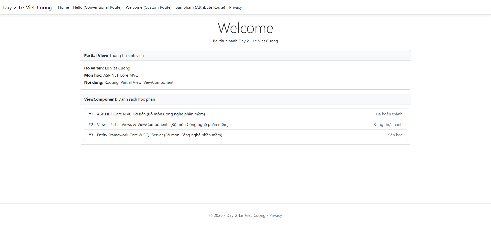
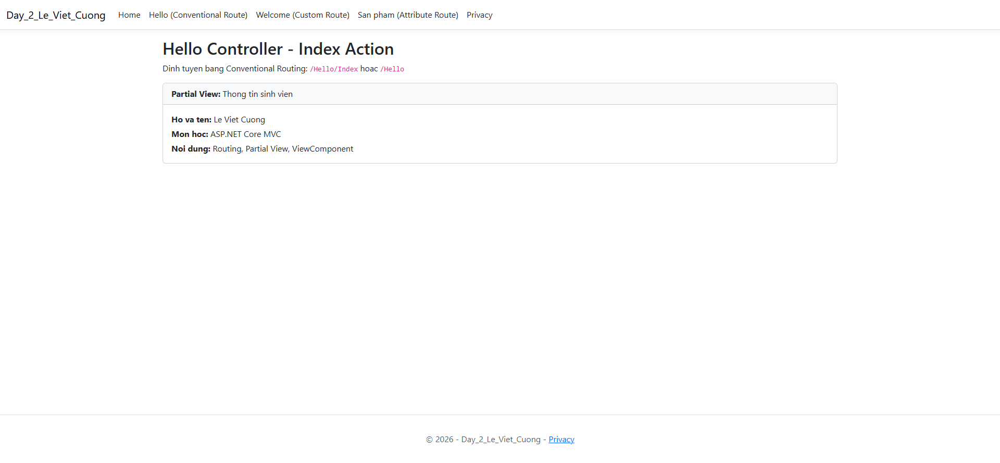
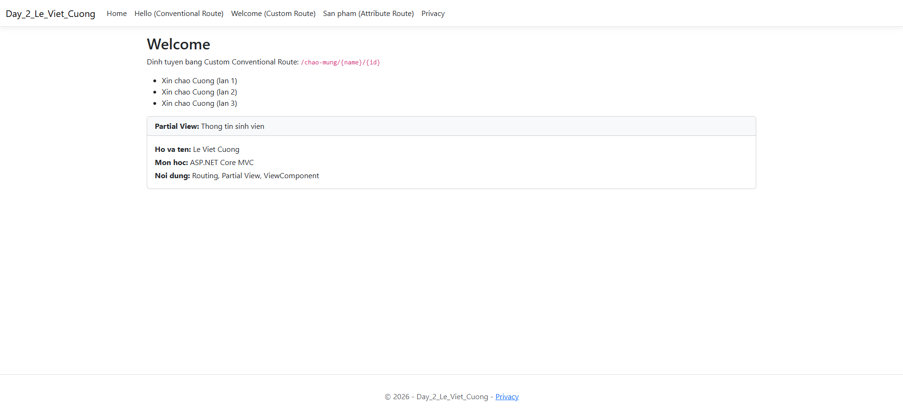
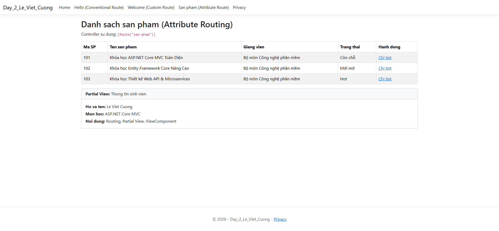
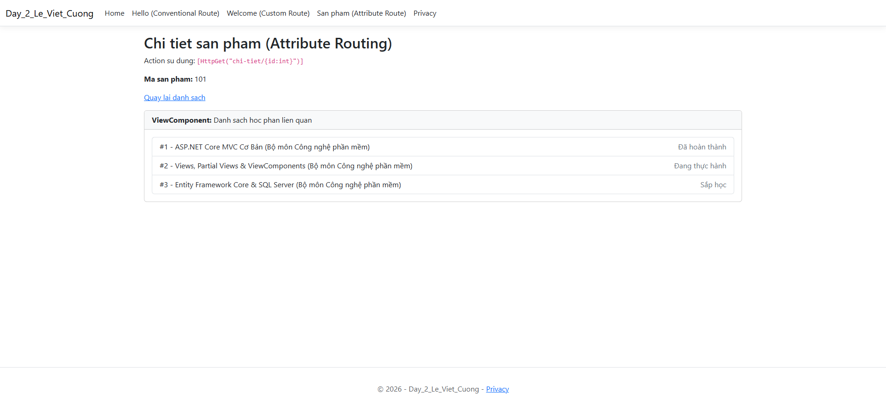
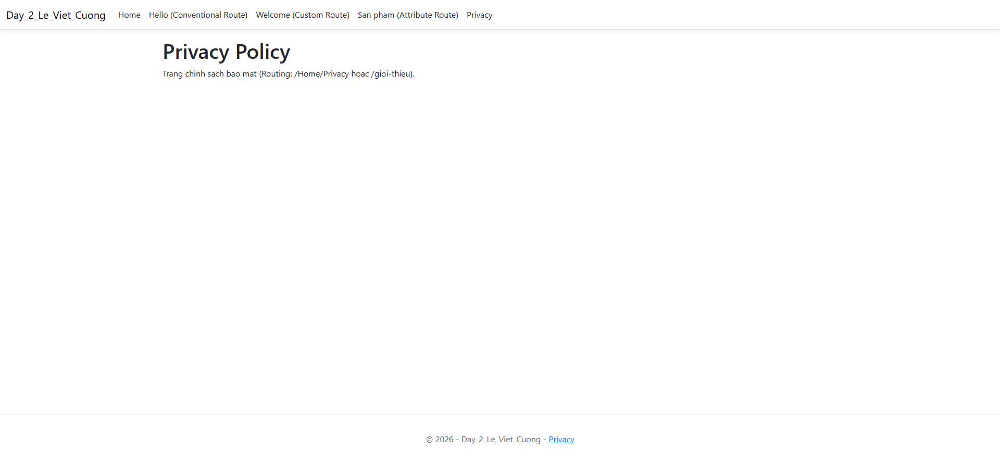

# Bài Thực Hành ASP.NET Core MVC - Day 2

**Sinh viên:** Lê Việt Cường  
**Học phần:** Phát triển ứng dụng Web với ASP.NET Core MVC  

---

## 1. Cấu trúc thư mục repository
```text
ASP.NET/
├── Day2/
│   └── Day_2_Le_Viet_Cuong/         # Mã nguồn dự án Day 2
│       ├── Controllers/             # HomeController, HelloController, ProductController
│       ├── Models/                  # CourseItem, ErrorViewModel
│       ├── ViewComponents/          # CourseListViewComponent
│       ├── Views/                   # Views, Partial Views, ViewComponent templates
│       ├── wwwroot/                 # Static assets (Bootstrap, jQuery, CSS, JS)
│       ├── Program.cs               # Cấu hình Routing (Conventional & Attribute)
│       └── Day_2_Le_Viet_Cuong.slnx
├── Picture/                         # Ảnh chụp màn hình các trang web
│   ├── 01_Home_Index.png
│   ├── 02_Hello_Index.png
│   ├── 03_Hello_Welcome.png
│   ├── 04_SanPham_List.png
│   ├── 05_SanPham_Details.png
│   └── 06_Privacy.png
└── README.md
```

---

## 2. Các tính năng đã triển khai

### A. Routing
1. **Conventional Routing (Định tuyến theo quy ước):**
   * Định tuyến mặc định: `{controller=Home}/{action=Index}/{id?}`
   * Định tuyến tùy biến 1: `chao-mung/{name}/{id:int?}` trỏ về `HelloController.Welcome`
   * Định tuyến tùy biến 2: `gioi-thieu` trỏ về `HomeController.Privacy`
2. **Attribute Routing (Định tuyến bằng thuộc tính):**
   * Controller `ProductController` dùng `[Route("san-pham")]`
   * Action `Index` dùng `[HttpGet("")]` và `[HttpGet("danh-sach")]`
   * Action `Details` dùng `[HttpGet("chi-tiet/{id:int}")]` với ràng buộc kiểu số nguyên.

### B. Partial View
* `Views/Shared/_StudentCardPartial.cshtml`: Thẻ hiển thị thông tin sinh viên thực hành, được tái sử dụng trong các Views (`Home`, `Hello`, `Product`).

### C. ViewComponent
* `ViewComponents/CourseListViewComponent.cs`: ViewComponent nạp danh sách học phần và truyền dữ liệu độc lập vào view template `Views/Shared/Components/CourseList/Default.cshtml`.

---

## 3. Ảnh chụp màn hình các trang giao diện (Chụp bằng Chrome DevTools)

### 3.1. Trang Chủ (Home Index) - Hiển thị Partial View và ViewComponent


### 3.2. Trang Hello Index (Conventional Routing)


### 3.3. Trang Chào Mừng (Custom Conventional Routing `/chao-mung/Cuong/3`)


### 3.4. Trang Danh Sách Sản Phẩm (Attribute Routing `/san-pham`)


### 3.5. Trang Chi Tiết Sản Phẩm (Attribute Routing `/san-pham/chi-tiet/101`)


### 3.6. Trang Privacy / Giới Thiệu (`/gioi-thieu`)

